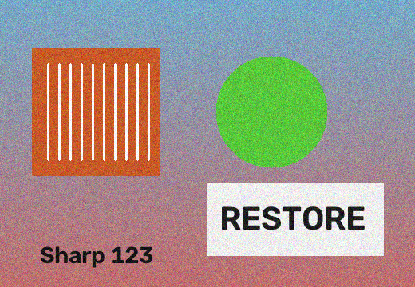
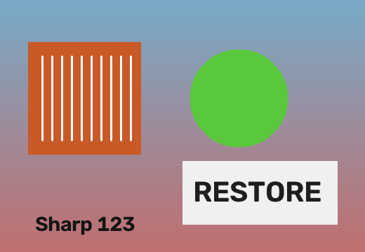
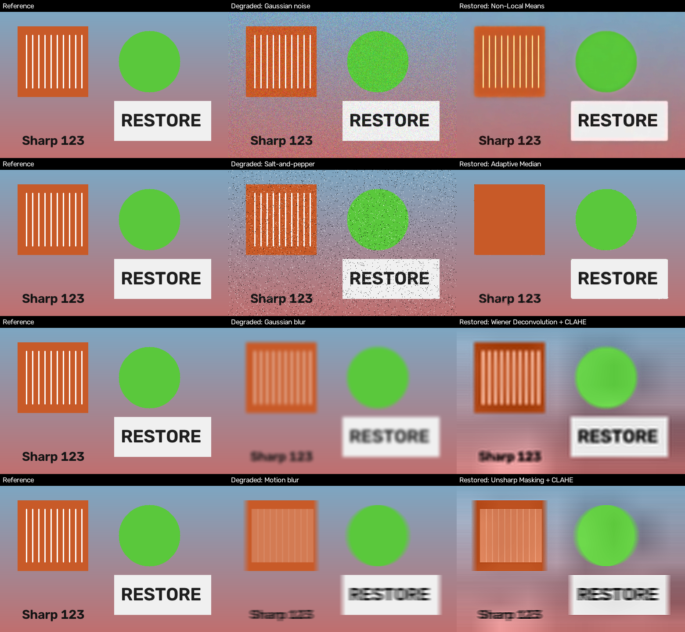

Documentation: https://mohammad-samiul-alam.github.io/deblur-image-restoration/

<h1>Deblur Image Restoration</h1>

<ul>
    <li><a href="filter_documentation.html">Filter Documentation</a></li>
    <li><a href="software_documentation.html">Software Documentation</a></li>
    <li><a href="viva_exam_documentation.html">Viva Exam Documentation</a></li>
</ul>


# Image Deblurring & Restoration Studio

A single-file desktop application for **automatic image deblurring and restoration** using traditional Digital Image Processing (DIP) techniques. Upload an image and the app analyses it, recommends a restoration plan with the reason for every step, and applies it automatically. You can then fine-tune everything manually.


## Features

- **Automatic analysis on upload**: detects impulse (salt-and-pepper) noise, Gaussian noise, blur level and type (defocus vs. motion, with estimated angle), contrast and exposure.
- **Smart restoration plan**: picks the filter, kernel size and strength, and explains *why* in a Recommendation Panel.
- **Multi-step pipeline**: plans can chain several filters (e.g. impulse removal → denoise → deblur → contrast). Add, remove, reorder and run steps in an editable Filter Pipeline.
- **Manual override**: controls are pre-filled with the recommended values, and you can change any filter or parameter.
- **Quality metrics**: PSNR / SSIM / MSE when a reference image is loaded.
- **Test degradations**: add synthetic Gaussian noise, salt-and-pepper noise, Gaussian blur or motion blur to try the pipeline.
- **Non-blocking UI**: processing runs in a background thread with a progress indicator.
- **Side-by-side preview** of original and restored images, with an optional actual-size scrolling mode.
- Handles file paths with non-ASCII characters.

## Screenshots

<!-- Replace the file names below with the actual files in the images/ folder -->

| Main window | Before / After |
|---|---|
|  |  |
<p align="center">
  
</p>

## Installation

```bash
git clone https://github.com/Mohammad-Samiul-Alam/deblur-image-restoration.git
cd deblur-image-restoration
pip install opencv-python numpy scipy pillow scikit-image
```

> `scikit-image` is optional. Without it, only MSE is shown (no PSNR/SSIM) and Richardson-Lucy may be unavailable. Tkinter ships with most Python installers; on some Linux distros install it with `sudo apt install python3-tk`.

## Usage

```bash
python image_restoration.py
```

1. Click **Upload Image** (restoration runs automatically if *Auto after upload* is checked).
2. Read the **Analysis** and **Recommendation** panels to see what was detected and why each step was chosen.
3. Adjust filters in the manual controls or the **Filter Pipeline** tab, then press **Apply Selected Filter** or **Run Pipeline**.
4. (Optional) Click **Load Reference** to compare against a ground-truth image and see PSNR/SSIM.
5. Click **Save Result** to export as PNG, JPEG, BMP or TIFF.

**Supported formats:** `.jpg`, `.jpeg`, `.png`, `.bmp`, `.tif`, `.tiff`

## Toolbar & Controls

| Control | Description |
|---|---|
| Upload Image | Load an image and analyse it |
| Load Reference | Load a clean image for PSNR/SSIM comparison |
| Automatic Restore | Re-run analysis, recommendation and restoration |
| Save Result | Save the restored image |
| Reset | Return to the originally loaded image |
| Auto after upload | Apply the recommended plan right after upload |
| Actual size (scroll) | Show previews at full resolution with scrolling |
| Apply on current result | Chain manual filters on the previous result |
| Use Recommended Settings | Reload the recommended values into the controls |
| Use Restored as Original | Make the result the new working input |

## Available Filters

| Category | Filters |
|---|---|
| Noise removal | Mean, Median, Adaptive Median, Gaussian, Bilateral, Wiener Denoise, Non-Local Means |
| Deblurring | Wiener Deconvolution, Richardson-Lucy (Gaussian or Motion PSF, adjustable angle) |
| Sharpening | Laplacian Sharpen, Unsharp Masking, High-Boost |
| Contrast / exposure | CLAHE, Gamma Correction |

## How the Automatic Mode Works

**1. Analysis**

| Measurement | Method |
|---|---|
| Impulse noise | Pixels that are near-black/white *and* differ strongly from their 3×3 median |
| Gaussian noise (σ) | Immerkaer's Laplacian-difference estimator with a robust median statistic |
| Blur level | Laplacian variance (noise-corrected) on a size-normalised copy: none / moderate / strong / very strong |
| Blur type & angle | Gradient structure-tensor anisotropy; blur direction is perpendicular to the dominant gradient |
| Contrast & exposure | Grayscale standard deviation and mean intensity |

**2. Recommendation** (order matters, since deconvolution amplifies noise):

1. **Impulse removal**: Median or Adaptive Median (window grows with impulse density)
2. **Gaussian denoising**: Bilateral (low noise) or Non-Local Means (moderate/high noise)
3. **Deblurring**: Wiener Deconvolution with a motion or Gaussian PSF for strong blur, or Unsharp Masking for moderate blur
4. **Contrast / exposure**: CLAHE or Gamma Correction

## Limitations

- All detection is **heuristic**, not ground truth. Always review the result.
- Blind deblurring is an **ill-posed problem**. Blur type (Gaussian vs. motion) and motion angle are estimated from gradient statistics and may be wrong. Use the manual controls to correct them.
- PSNR/SSIM are only calculated when a reference image is loaded.

## Project Structure

```
.
├── image_restoration.py   # Complete application (single file)
├── images/                # Screenshots used in this README
└── README.md
```

Inside `image_restoration.py`:

- **Image utilities**: robust read/write, display helpers
- **Detection & analysis**: `detect_impulses`, `estimate_gaussian_sigma`, `estimate_motion_direction`, `analyze_image`
- **DIP filters**: `adaptive_median_filter`, `wiener_deconvolution`, `richardson_lucy_deblur`, `unsharp_mask`, `clahe_enhance`, etc.
- **Planning**: `recommend_plan`, `apply_plan`, `automatic_restore`
- **GUI**: `ImageRestorationApp` (Tkinter)

## Use as a Library

The processing functions can be used without the GUI:

```python
from image_restoration import read_image, save_image, automatic_restore

image = read_image("blurry.jpg")
result, info, plan = automatic_restore(image)
save_image("restored.png", result)

for step in plan:
    print(step.filter, step.kernel, step.strength)
```

## Requirements

- Python 3.8+
- opencv-python
- numpy
- scipy
- pillow
- scikit-image (optional)

## License

Add your license here (e.g. MIT).
